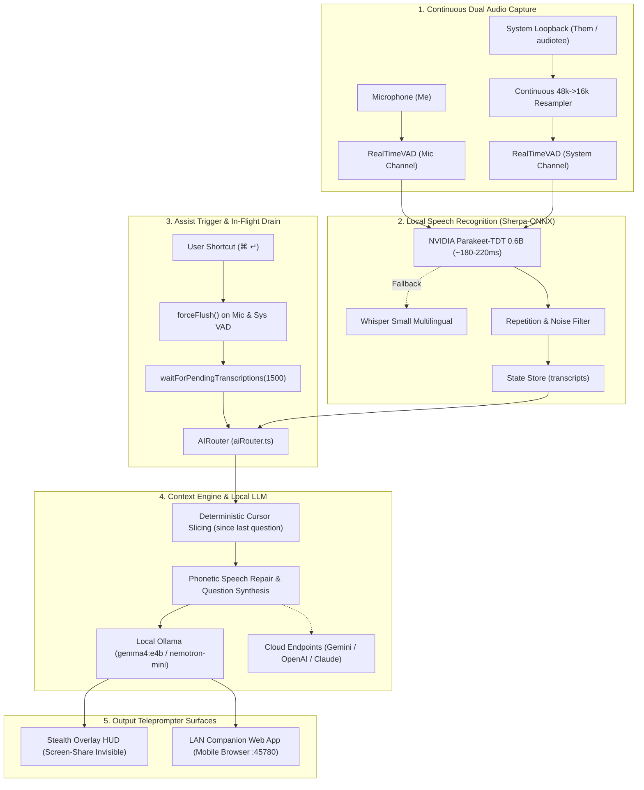

# Cluely Studio

<p align="center">
  <strong>Ultra-Low-Latency, Multimodal Stealth AI Meeting Teleprompter & Real-Time Interview Copilot</strong>
</p>

<p align="center">
  
  
  
  
  
  
  
</p>

---

## ⚡ Core Capabilities

- **🏎️ Instant Teleprompting (< 150ms TTFT)**: Powered by local Ollama (`gemma4:e4b` / `nemotron-mini`) with `think: false` and strict token ceilings, delivering candidate-ready spoken answers without thinking latency.
- **🎙️ Sub-200ms Offline Speech Recognition**: Dual-channel continuous capture (`Me` via microphone, `Them` via system loopback audio) processed locally on Apple Silicon using native Sherpa-ONNX (NVIDIA Parakeet-TDT 0.6B + Whisper Small).
- **⚡ Force-Flush VAD on `⌘ ↵`**: Instantly flushes buffered speech audio ($\ge 180\text{ms}$) and awaits pending ASR commits before querying AI, ensuring speech spoken right before hitting Command+Enter is never lost.
- **🎯 Deterministic Spoken Segment Cursor Slicing**: Uses a `lastConsumedTranscriptId` cursor to isolate all speech since the last answered question, ensuring typed text queries never override fresh spoken speech.
- **🧠 Phonetic Error Repair & Question Synthesis**: Silently detects and corrects ASR phonetic errors against mode ground truth and synthesizes overarching questions across multi-sentence conversational turns.
- **💼 Copilot Modes Framework**: Switchable personas including **Gen AI** (featuring complete NewsLens-AI project ground truth), **Interview**, **System Design**, **Coding**, and **Behavioral**.
- **📱 Stealth LAN Companion Web App**: Embedded WebSocket server (`:45780`) enabling discreet mobile or tablet teleprompting with zero on-screen footprint.
- **🛡️ 100% Screen Share Invisibility**: Uses macOS native `setContentProtection(true)` to hide the overlay card from Zoom, Microsoft Teams, Google Meet, and screen recordings.

---

## 🏗️ System Architecture



---

## 🚀 Quick Start

### 1. Prerequisites
- macOS 13+ (Ventura, Sonoma, Sequoia) on Apple Silicon (M1/M2/M3/M4 recommended) or Intel.
- Node.js 18+ (Node 20+ recommended).
- [Ollama](https://ollama.ai) installed and running in the background.

### 2. Installation
```bash
git clone https://github.com/piyushgoel2808/Cluely.git
cd Cluely
npm install
```

### 3. Pull Ollama Models
```bash
# Recommended ultra-fast reasoning model (~140ms TTFT)
ollama pull gemma4:e4b

# Ultra-lightweight fallback model
ollama pull nemotron-mini

# Semantic personal memory embeddings
ollama pull all-minilm
```

### 4. Download Offline Speech Models
Download the optimized INT8 ONNX models for Sherpa-ONNX:
```bash
chmod +x scripts/download_models.sh
./scripts/download_models.sh
```

### 5. Run in Development Mode
```bash
npm run dev
```

### 6. Build & Package
```bash
# Build Electron main and preload
npm run build:electron

# Build full production web & electron bundles
npm run build

# Package macOS DMG / Application bundle
npm run package:mac
```

---

## 📚 Technical Documentation

Comprehensive architectural and implementation guides are available in the [`docs/`](./docs/) directory:

| Document | Topic |
|---|---|
| [**01. System Architecture**](./docs/01_SYSTEM_ARCHITECTURE.md) | Electron process model, window management, persistent store, and IPC data contracts. |
| [**02. Audio & Transcription Pipeline**](./docs/02_AUDIO_AND_TRANSCRIPTION_PIPELINE.md) | Dual-channel capture, VAD force-flush, continuous resampler, and Sherpa-ONNX runtime. |
| [**03. AI Router & LLM Integration**](./docs/03_AI_ROUTER_AND_LLM_INTEGRATION.md) | Multi-provider router, Gemma 4 optimization, single-flight stream aborts, and screen vision. |
| [**04. Prompt Engineering & Speech Repair**](./docs/04_PROMPT_ENGINEERING_AND_SPEECH_REPAIR.md) | Deterministic cursor slicing, acoustic ASR error repair, and multi-sentence question synthesis. |
| [**05. Modes & Interview Copilot**](./docs/05_MODES_AND_INTERVIEW_COPILOT.md) | Copilot personas framework and verified NewsLens-AI codebase ground truth. |
| [**06. Sessions, History & Companion Web App**](./docs/06_SETTINGS_SESSIONS_AND_COMPANION.md) | Session lifecycle, timeline event tracking, and LAN WebSocket companion teleprompter. |
| [**07. Developer Guide & Troubleshooting**](./docs/07_DEVELOPER_GUIDE_AND_TROUBLESHOOTING.md) | Setup instructions, macOS permissions, and debugging runbooks. |

---

## ⌨️ Default Shortcuts

| Shortcut | Action | Description |
|---|---|---|
| `⌘ ↵` | **Ask Cluely** | Flushes pending audio and triggers instant answer for live conversation. |
| `⌘ ,` | **Settings** | Opens the Settings and Past Sessions window. |
| `⌘ M` | **Cycle Mode** | Toggles between Copilot modes (General, Gen AI, Interview, etc.). |
| `Escape` | **Dismiss / Collapse** | Minimizes or collapses the active response card. |

---

## 📄 License

This project is licensed under the MIT License.
