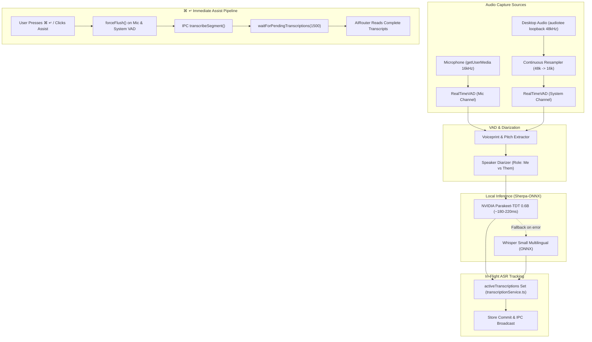

# 02. Audio & Transcription Pipeline

## Overview

The audio pipeline provides continuous, zero-latency speech recognition across two distinct physical channels:
1. **User Voice (`Me`)**: Captured directly from the local microphone.
2. **Meeting Participants (`Them`)**: Captured via system loopback audio using `audiotee` (or BlackHole virtual audio driver).

Speech is processed locally and offline on Apple Silicon, achieving end-to-end transcription latency under **200ms**.

---

## 1. End-to-End Pipeline Architecture

---

## 2. Core Components

### 1. Continuous Linear-Interpolation Resampler
System audio drivers on macOS commonly output at **48,000 Hz**, whereas modern speech models (NVIDIA Parakeet, Whisper) strictly expect **16,000 Hz**.
- Implemented as [`ContinuousResampler`](file:///Users/piyushgoel/Downloads/Projects/Cluely/CluelyStudio/src/hooks/useAudioPipeline.ts#L15-L66).
- Maintains stateful fractional phase and boundary samples across block boundaries, preventing audio clicks, sample truncation, and 23Hz audio aliasing buzzing.

### 2. Client-Side Real-Time VAD ([`RealTimeVAD`](file:///Users/piyushgoel/Downloads/Projects/Cluely/CluelyStudio/src/services/vadAndDiarization.ts#L270))
- Operates on 20ms audio frames (320 samples at 16kHz).
- Evaluates multi-band spectral energy, zero-crossing rate (ZCR), and Root-Mean-Square (RMS) amplitude against adaptive speech thresholds.
- Supports latency profiles:
  - `ultra-low`: 380ms silence hang-over for instant partial emission.
  - `balanced`: 650ms silence hang-over (recommended).
  - `high-accuracy`: 1050ms silence hang-over for complete sentence finalization.

### 3. Immediate VAD Force-Flush on Assist (`forceFlush()`)
When an interviewer finishes speaking and the candidate hits `⌘ ↵` (Command+Enter), the standard VAD silence hang-over (650ms–1050ms) plus ASR inference time would cause the AI to trigger *before* the spoken sentence reaches the transcript store.

To solve this race condition:
1. **`RealTimeVAD.forceFlush(): Int16Array | null`**:
   - If audio buffer contains at least 180ms of audio (2,880 samples) and speech was active, `forceFlush()` immediately packages the segment, computes voiceprint metrics, resets internal buffers, and returns the segment as finalized (`isPartial: false`).
2. **`useAudioPipeline.flushPendingSpeech(): Promise<void>`**:
   - Exposed directly to the UI layer. Flushes both Mic and System VAD channels and registers all generated transcription promises in `inFlightTranscriptionsRef`.
3. **`transcriptionService.waitForPendingTranscriptions(maxWaitMs = 1500)`**:
   - Tracks all in-flight ASR promises in a thread-safe `Set<Promise<unknown>>`.
   - The AI Router awaits this function before slicing transcripts, guaranteeing 100% of spoken words are written to `store.transcripts` before the LLM generates an answer.

### 4. Speaker Diarization & Role Assignment ([`SpeakerDiarizer`](file:///Users/piyushgoel/Downloads/Projects/Cluely/CluelyStudio/src/services/vadAndDiarization.ts#L80))
- **Strict Channel Grounding**: In online meeting mode, any audio coming from the `mic` channel is unconditionally assigned to **`Me`** (`role: 'me'`), while audio captured from system loopback is assigned to **`Them`** (`role: 'them'`).
- Computes acoustic voiceprints (MFCC spectral centroid & pitch mean) to identify different participant voices (`Speaker-1`, `Speaker-2`, etc.) on the system channel.

### 5. Local Offline Model Runtime ([`localModelManager.ts`](file:///Users/piyushgoel/Downloads/Projects/Cluely/CluelyStudio/electron/domains/localModelManager.ts))
Uses pre-compiled native bindings to `sherpa-onnx-node`:
- **Primary Engine**: `sherpa-onnx-nemo-fast-conformer-tdt-en-24500` (NVIDIA Parakeet-TDT 0.6B).
  - TDT (Token-and-Duration Transducer) architecture decodes multiple speech tokens per acoustic frame, slashing inference latency to **~180-220ms** on Apple Silicon M-series chips.
- **Multilingual Fallback**: `sherpa-onnx-whisper-base` and `whisper-small` for non-English speech and accented phrases.
- **Single-Engine Memory Consolidation**: Instances share ONNX session pools to keep total memory under **450MB RAM**.

---

## 3. Repetition Cleaning & Noise Suppression

Live speech models often hallucinate repeated tokens on background noise or microphone hum. Cluely Studio incorporates the exact Meetily repetition cleaner in [`transcriptionService.ts`](file:///Users/piyushgoel/Downloads/Projects/Cluely/CluelyStudio/electron/domains/transcriptionService.ts#L120):
1. **Bracketed Token Stripper**: Removes `[applause]`, `(laughter)`, `(whispering)`, `(music)`.
2. **Phrase Repetition Elimination**: Suppresses loops like *"thank you thank you thank you"* using regex matching on repeated n-grams.
3. **Empty/Filler Elimination**: Discards segments consisting purely of conversational clicks or coughs.
