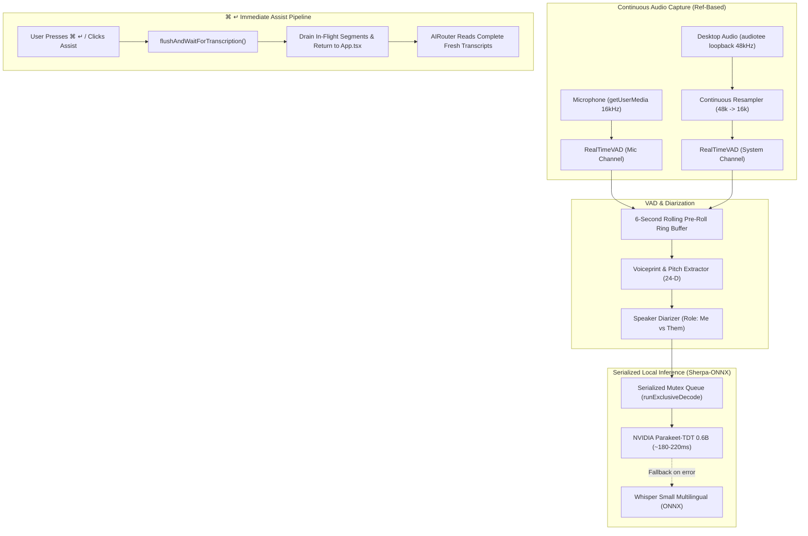

# 02. Audio & Transcription Pipeline

## Overview

The audio pipeline provides continuous, zero-latency speech recognition across two distinct physical channels:
1. **User Voice (`Me`)**: Captured directly from the local microphone via WebAudio `getUserMedia`.
2. **Meeting Participants (`Them`)**: Captured via macOS CoreAudio system loopback using `audiotee` (or desktop audio fallback).

Speech is processed locally on Apple Silicon / CUDA, achieving end-to-end transcription latency under **200ms**.

---

## 1. End-to-End Pipeline Architecture



---

## 2. Core Upgrades & Architectural Fixes

### 1. Ref-Based State Immunity (`useAudioPipeline.ts`)
- **Problem**: When React components re-rendered or AI streaming chunks updated component state, dependencies in `useEffect` and `useCallback` caused the WebAudio `AudioContext` and VAD handlers to tear down and recreate, dropping words mid-sentence.
- **Fix**: Mutable state and voice profiles are encapsulated in persistent `configRef.current`:
  ```typescript
  const configRef = useRef({
    meetingEnvironment: state?.meetingEnvironment || 'online',
    voiceProfiles: state?.voiceProfiles || [],
  });
  ```
- Audio pipelines, VAD instances, and stream listeners are instantiated once and remain 100% continuous throughout the entire lifecycle.

### 2. 6-Second Rolling Ring Buffer (`vadAndDiarization.ts`)
- Maintains a circular pre-roll buffer of raw 16kHz PCM audio frames.
- When speech-onset is detected, the preceding 600ms of audio is stitched onto the segment to guarantee leading consonants and breath-in pauses are never clipped.

### 3. Serialized ONNX Decode Mutex Queue (`localModelManager.ts`)
- `sherpa-onnx-node` runs native C++ bindings for ONNX inference. If `Me` and `Them` speech segments finished simultaneously, concurrent decodes collided on CPU/GPU execution threads.
- Added a strict mutex queue:
  ```typescript
  private async runExclusiveDecode<T>(fn: () => Promise<T>): Promise<T> {
    const prev = this.decodeMutex;
    let resolver: () => void;
    this.decodeMutex = new Promise<void>((r) => { resolver = r; });
    await prev;
    try {
      return await fn();
    } finally {
      resolver!();
    }
  }
  ```
- All speech segments decode sequentially without racing.

### 4. Immediate Flush on Assist (`flushAndWaitForTranscription`)
- When the user presses `⌘↵` or clicks **Assist**:
  1. Any uncommitted audio currently held in the VAD hangover buffer is forced into a final segment.
  2. The pipeline awaits in-flight transcription promises.
  3. The freshly transcribed segments are returned directly to `App.tsx` and injected into the prompt payload before the LLM stream begins.
