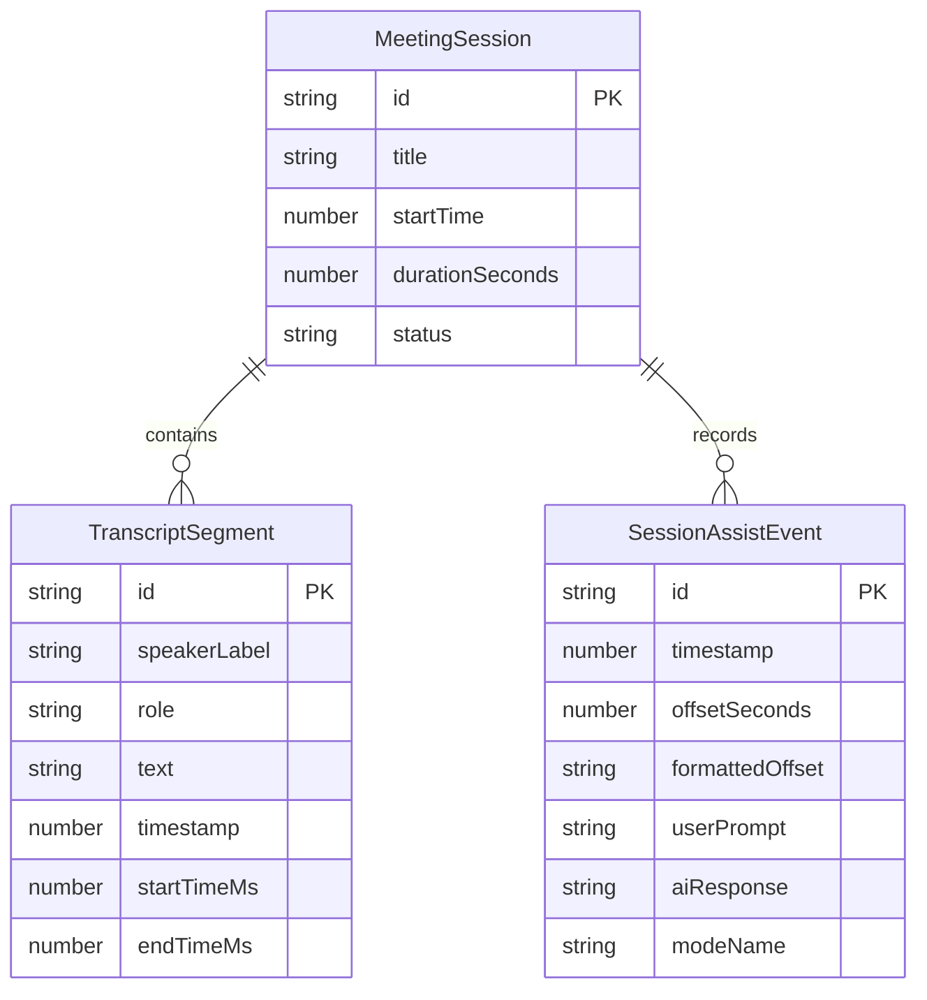

# 06. Settings, Sessions & Companion Web App

## Overview

Cluely Studio includes tools for reviewing past meetings, analyzing conversation timelines with embedded AI assist responses, and projecting teleprompter answers to external mobile devices.

---

## 1. Meeting Session Management

Sessions are continuously recorded and managed by [`store.ts`](file:///Users/piyushgoel/Downloads/Projects/Cluely/CluelyStudio/electron/domains/store.ts#L430-L510):
- **Lifecycle**: Automatically begins when `isSessionActive` is enabled.
- **Duration Tracking**: Continuously updates elapsed seconds and creates formatted offsets (`M:SS`).
- **Dynamic Session Titling**: When a new session accumulates 2 or more speech segments, the session title is automatically generated from the first conversational topic.

---

## 2. Interactive Timeline Viewer (`SessionsHistoryView.tsx`)

Accessible directly from the **Sessions & History** tab in Settings or by clicking the active session pill in the overlay card:
- **Unified Timeline**: Merges speech transcript utterances (`Me` and `Them`) with AI Assist events in strict chronological order.
- **Synthesized Question Titles**: Each assist event displays the actual spoken question or interview inquiry that triggered it, rather than a generic prompt string.
- **Search & Filtering**: Real-time keyword search across session titles, transcript text, and AI responses.
- **Export & Management**: Export session logs or clear old meetings.

---

## 3. LAN Companion Server (`companionServer.ts`)

For situations where an on-screen overlay is undesirable (e.g. sharing your entire desktop or being recorded on a high-resolution camera):
1. **Server Initialization**: Cluely launches an embedded HTTP and WebSocket server on `http://192.168.x.x:45780/companion`.
2. **Zero-Setup Pairing**: Displays a QR code or direct IP URL in Settings.
3. **Real-Time Synchronized Teleprompting**:
   - Streams speech transcripts and AI response chunks directly to mobile Safari / Chrome over WebSockets.
   - Allows your phone or tablet propped next to your monitor to act as an invisible teleprompter.
