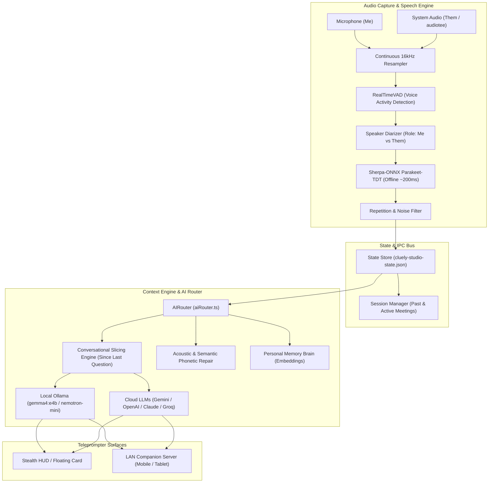

# Cluely & Cluely Studio Documentation

Welcome to the comprehensive technical and operational documentation for **Cluely / Cluely Studio** — an ultra-low-latency, multimodal stealth AI meeting teleprompter and real-time interview copilot.

---

## 📚 Documentation Index

| Section | Document | Description |
|---|---|---|
| **01** | [**System Architecture**](./01_SYSTEM_ARCHITECTURE.md) | High-level system topology, Electron process model, multi-window layout, state management, and IPC data contracts. |
| **02** | [**Audio & Transcription Pipeline**](./02_AUDIO_AND_TRANSCRIPTION_PIPELINE.md) | Dual-channel audio capture, client-side VAD, resampler, diarization (`Me` vs `Them`), and local offline Sherpa-ONNX (Parakeet-TDT & Whisper). |
| **03** | [**AI Router & LLM Integration**](./03_AI_ROUTER_AND_LLM_INTEGRATION.md) | Multi-provider AI streaming engine (Local Ollama, Gemini, OpenAI, Claude, Groq), Gemma 4 e4b / Nemotron optimization, and screen vision capture. |
| **04** | [**Prompt Engineering & Speech Repair**](./04_PROMPT_ENGINEERING_AND_SPEECH_REPAIR.md) | Multi-utterance conversational slicing engine, acoustic & phonetic error repair, and typed vs. spoken priority management. |
| **05** | [**Modes & Interview Copilot**](./05_MODES_AND_INTERVIEW_COPILOT.md) | Copilot modes framework, deep-dive on Gen AI & Interview modes, NewsLens AI project ground truth, and Personal Memory Brain. |
| **06** | [**Sessions, History & Companion Web App**](./06_SETTINGS_SESSIONS_AND_COMPANION.md) | Meeting session lifecycle, timeline viewer with assist events, and LAN WebSocket companion server for mobile stealth teleprompting. |
| **07** | [**Developer Setup & Troubleshooting**](./07_DEVELOPER_GUIDE_AND_TROUBLESHOOTING.md) | Prerequisites, local model installation, macOS permissions, build instructions, and end-to-end debugging runbooks. |

---

## ⚡ Core Architecture at a Glance

---

## 🌟 Key Technical Highlights

1. **Sub-200ms Offline Speech Recognition**: Runs NVIDIA Parakeet-TDT (0.6B) and Whisper Small entirely offline on Apple Silicon via `sherpa-onnx-node`.
2. **Sub-150ms Teleprompter Answers**: Runs Google Gemma 4 e4b / NVIDIA Nemotron-Mini via Ollama with `think: false` and strict token management, eliminating thinking lag.
3. **Multi-Turn Conversational Slicing**: Dynamically isolates speech blocks starting from the last answered question, ensuring multi-sentence interview questions are never truncated to single trailing fragments.
4. **ASR Phonetic & Semantic Error Repair**: Automatically repairs misheard technical terms (e.g. *"noose lens"* -> *NewsLens AI*, *"loosination"* -> *hallucination*, *"be m 25"* -> *BM25*) using active mode knowledge and session context.
5. **Zero Memory Collisions & OOM Guard**: Strict bounds on screen capture resolution (1280x720 JPEG), single-flight stream controller aborts, and consolidated ONNX engine instances.
