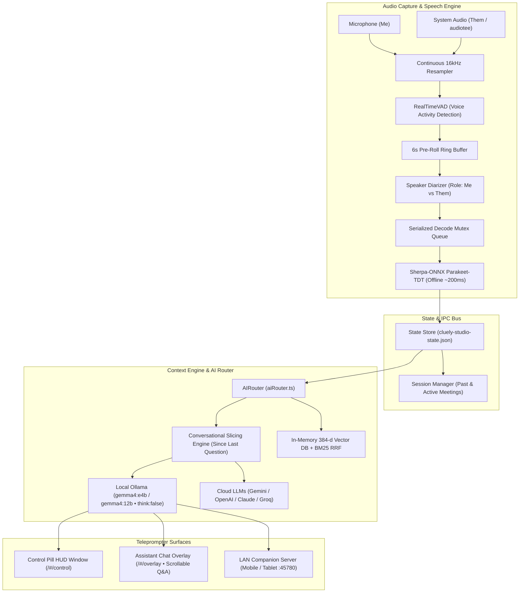

# Cluely & Cluely Studio Documentation

Welcome to the comprehensive technical and operational documentation for **Cluely / Cluely Studio** — an ultra-low-latency, multimodal stealth AI meeting teleprompter and real-time interview copilot.

---

## 📚 Documentation Index

| Section | Document | Description |
|---|---|---|
| **01** | [**System Architecture**](./01_SYSTEM_ARCHITECTURE.md) | High-level system topology, Electron process model, 3-window layout (Control Pill HUD, Overlay, Settings), state management, and stealth screen protection. |
| **02** | [**Audio & Transcription Pipeline**](./02_AUDIO_AND_TRANSCRIPTION_PIPELINE.md) | Dual-channel continuous capture, ref-based state immunity, 6s ring buffer, diarization (`Me` vs `Them`), and serialized Sherpa-ONNX decoding. |
| **03** | [**AI Router & LLM Integration**](./03_AI_ROUTER_AND_LLM_INTEGRATION.md) | Multi-provider AI streaming engine, 2–3s quick-thinking Gemma 4 tuning (`think: false`), in-memory 384-d vector RRF, and screen vision capture. |
| **04** | [**Prompt Engineering & Speech Repair**](./04_PROMPT_ENGINEERING_AND_SPEECH_REPAIR.md) | Multi-utterance conversational slicing engine, acoustic & phonetic error repair, and typed vs. spoken priority management. |
| **05** | [**Modes & Interview Copilot**](./05_MODES_AND_INTERVIEW_COPILOT.md) | Copilot modes framework, deep-dive on Gen AI & Interview modes, document chunking, and Personal Memory Brain. |
| **06** | [**Sessions, History & Companion Web App**](./06_SETTINGS_SESSIONS_AND_COMPANION.md) | Meeting session lifecycle, continuous scrollable Q&A feed, live overlay opacity slider (20%–100%), and LAN WebSocket companion server. |
| **07** | [**Developer Setup & Troubleshooting**](./07_DEVELOPER_GUIDE_AND_TROUBLESHOOTING.md) | Prerequisites, local model installation, macOS permissions, build instructions, dedicated port 5188, and troubleshooting runbooks. |

---

## ⚡ Core Architecture at a Glance

---

## 🌟 Key Technical Highlights

1. **Pixel-Perfect Control Pill HUD & Multi-Window Topology**: Frameless floating pill (`196x54px`) with the blue C logo, Ask capsule button, mic session toggle, and settings gear, backed by the 668px expandable assistant overlay.
2. **Sub-2.5s Quick-Thinking Local LLM**: Runs Google Gemma 4 e4b / 12b via Ollama with `think: false`, `num_ctx: 2048`, and `num_predict: 280`, pre-warmed on launch with `keep_alive: -1`.
3. **In-Memory Vector Search**: 384-d feature hashing vector search + BM25 Hybrid Reciprocal Rank Fusion (RRF) runs in <1ms in Node.js, completely eliminating the 4–8s model-swapping delay in Ollama.
4. **Continuous, Teardown-Immune Audio Pipeline**: Persistent ref-based audio hooks in `useAudioPipeline.ts` eliminate React re-render audio drops, supplemented by a 6s ring buffer and serialized ONNX decoding mutex.
5. **Continuous Scrollable Session Q&A Feed**: Every answer in the active session stays permanently visible and scrollable in the teleprompter drawer.
6. **Unified Global App Toggle (`⌘\`) & Live Opacity Slider**: Toggle all Cluely windows at once or adjust overlay transparency from 20% to 100% in real time.
7. **Hardware Stealth Protection**: `win.setContentProtection(true)` enforces Cocoa `NSWindowSharingNone` on macOS, ensuring the assistant is 100% invisible on Zoom, Teams, Meet, Slack, and OBS.
